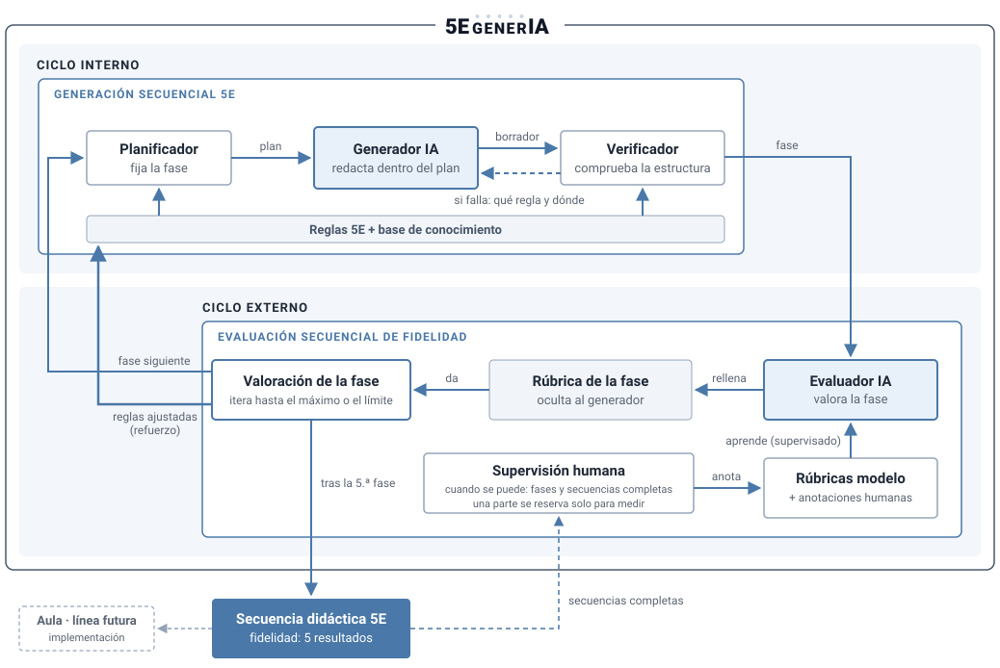

<!--
  5EgenerIA — documento único de la propuesta, en una sola página.
  Es la fuente de la web: `python build_web.py` genera docs/presentacion.html (y la portada).
  Secciones (##) desplegables, cerradas al cargar; el itinerario se muestra como filas desplegables.
-->

# 5EgenerIA — Propuesta de colaboración post-TFM

**De:** Javier Piay Pombo\
**Para:** mi director de TFM

**Aplicación de inteligencia artificial para generar\
secuencias didácticas de astronomía y astrofísica\
fieles al modelo 5E**

> Esta propuesta ratifica mi intención de seguir trabajando con mi director de TFM en una colaboración en el ámbito de la aplicación de la inteligencia artificial y las nuevas herramientas TIC a la didáctica de la Física, centrada en la generación de secuencias didácticas de astronomía y astrofísica siguiendo el modelo 5E.
>
> Se plantea un proceso secuencial en el que cada fase se genera mediante inteligencia artificial a partir de las directrices del modelo y se evalúa con una rúbrica antes de avanzar a la siguiente, favoreciendo así la revisión progresiva y la coherencia pedagógica del conjunto.
>
> El proyecto se concibe como una investigación basada en diseño (*design-based research*), articulada en un itinerario de estudios publicables, progresivos y condicionados a los resultados de cada etapa, que podrían integrarse en una tesis doctoral: un horizonte ambicioso, pero sustentado en una planificación gradual, una metodología explícita y la evaluación sistemática de los resultados.

## El problema

El modelo 5E, desarrollado por BSCS (Bybee et al., 2006), organiza la enseñanza de las ciencias en cinco fases: *Engage* (implicar), *Explore* (explorar), *Explain* (explicar), *Elaborate* (aplicar) y *Evaluate* (evaluar).

Pero el 5E no consiste en repartir contenidos en cinco apartados: cada fase cumple una función didáctica y se apoya en la anterior. El informe de BSCS relaciona la fidelidad con que se aplica el modelo con el aprendizaje (Bybee et al., 2006). La fidelidad de implementación empieza, en parte, por el diseño: una secuencia escrita que no respeta la función y el orden de las fases dificulta una aplicación fiel del modelo. No obstante, la fidelidad de diseño y la de implementación son cuestiones distintas, y esta última queda fuera de los primeros estudios.

La IA generativa facilita elaborar secuencias, pero no garantiza esa fidelidad. Produce planes con las cinco fases que *parecen* 5E, pero cuya exploración no es indagación y cuya explicación no parte de los datos del alumnado (Goodman et al., 2024); en algunos casos explica el contenido antes de que el alumnado explore (Peikos y Stavrou, 2025). Hoy, detectar estos fallos depende del criterio del docente, caso a caso.

## La solución

5EgenerIA propone una generación y una evaluación secuenciales que trabajan juntas, fase a fase: el generador produce una fase y el evaluador valora su fidelidad antes de pasar a la siguiente, como se ilustra en el siguiente diagrama:



```algoritmo
Algoritmo 1. Generación y evaluación de una secuencia, fase a fase

Entrada:  ficha de diseño D (tema, nivel y objetivos, que aporta el docente),
          reglas R, rúbrica por fases B, niveles mínimo y máximo de cada fase,
          límite de iteraciones K, rúbricas modelo y anotaciones humanas A
Salida:   secuencia S y su fidelidad F = (f₁, …, f₅), un resultado por fase

 1  si hay anotaciones nuevas: AprenderEvaluador(A)     ▷ función 4: supervisado
 2  S ← ∅
 3  para cada fase i ∈ (Engage, Explore, Explain, Elaborate, Evaluate):
 4      mejor ← ninguna
 5      para k = 1, …, K:
 6          fase ← GenerarFase(i, S, D, R)              ▷ función 1: ciclo interno
 7          v ← ValorarFase(fase, S, Bᵢ)                ▷ función 2: ciclo externo
 8          si v mejora a mejor: mejor ← (fase, v)
 9          si v alcanza el máximo: salir del bucle
10          R ← AjustarReglas(R, v)                     ▷ función 3: refuerzo, desde E5
11      si la valoración de mejor no alcanza el mínimo:
12          detener y registrar el caso
13      S ← S + fase de mejor;  fᵢ ← valoración de mejor
14  devolver S, F

El evaluador aprende antes de empezar cada secuencia, no a mitad: sus cinco
valoraciones son así comparables entre sí. R se conserva entre secuencias:
los ajustes que mejoran perduran.
```

Las funciones se apoyan en seis **primitivas**, que se describen por lo que reciben y devuelven; su implementación se define en el estudio indicado:

| Primitiva | Recibe → devuelve | Cómo funciona | Se define en |
|---|---|---|---|
| `Planificador` | ficha, reglas y fases previas → plan de la fase | Reglas y base de conocimiento | E4 |
| `GeneradorIA` | plan y fases previas → borrador de la fase | Modelo de lenguaje con instrucciones | E4 |
| `Verificador` | borrador y reglas → fallos estructurales | Reglas | E4 |
| `EvaluadorIA` | fase y criterio → nivel, tipo de error y evidencia | Modelo de lenguaje con instrucciones y ejemplos | E3 |
| `Ajustar` | evaluador y anotaciones → evaluador ajustado | Instrucciones y ejemplos; entrenar, solo si hay datos | E3 |
| `ProponerCambio` | reglas y valoración → reglas candidatas | A investigar | E5 |

**Generación secuencial: ciclo interno, genera cada fase.** Es un sistema híbrido que combina reglas del modelo 5E, una base de conocimiento y un generador IA. El planificador fija qué debe hacer la fase con las reglas y la base de conocimiento; el generador IA la redacta partiendo de las fases anteriores, y el verificador comprueba con las mismas reglas su estructura: si algo falla, indica qué regla se incumple y dónde, y el generador IA corrige esa parte. Las reglas cubren lo estructural y lo explícito; la fidelidad pedagógica de la fase la juzga el evaluador.

```algoritmo
Función 1. GenerarFase(i, S, D, R): ciclo interno

Recibe:   la fase i, las fases ya aceptadas S, la ficha D y las reglas R;
          nunca la rúbrica ni las valoraciones
Devuelve: un borrador de la fase, estructuralmente correcto

 1  plan ← Planificador(D, R, S, i)                 ▷ función y recursos de la fase
 2  repetir
 3      fase ← GeneradorIA(plan, S)                 ▷ redacta partiendo de S
 4      fallos ← Verificador(fase, R)               ▷ estructura y criterios explícitos
 5      si hay fallos: plan ← plan + fallos         ▷ qué regla y dónde
 6  hasta que no haya fallos
 7  devolver fase
```

**Evaluación secuencial de fidelidad: ciclo externo, evalúa cada fase.** Es un proceso separado de la generación. El **evaluador IA** rellena la **rúbrica** de la fase recién generada y obtiene su **valoración**. La rúbrica es el instrumento que define cómo debe ser una fase fiel: sus criterios, su enlace con la fase anterior y sus niveles mínimo y máximo. Si la fase no alcanza el nivel máximo y quedan iteraciones, la fase se genera de nuevo, con las reglas ajustadas por refuerzo a partir de E5; cuando alcanza el máximo o se agotan las iteraciones, y siempre que supere el mínimo, se pasa a la fase siguiente. Si tras el límite no alcanza el mínimo, la secuencia se detiene y el caso se registra. Al terminar la quinta fase, el resultado es la secuencia con su **fidelidad: cinco resultados, uno por fase**, sin notas globales que compensen unas fases con otras.

```algoritmo
Función 2. ValorarFase(fase, S, Bᵢ): ciclo externo

Recibe:   la fase, las fases ya aceptadas S y la rúbrica de la fase Bᵢ
Devuelve: la valoración v de la fase

 1  para cada criterio c de Bᵢ, incluido el enlace con la fase anterior:
 2      v_c ← EvaluadorIA(fase, S, c)               ▷ nivel, tipo de error y evidencia
 3      si no puede decidir: marcar c               ▷ se anota después (supervisión humana)
 4  devolver v = (v_c) para todos los criterios
```

**La circularidad se evita por diseño:** el generador nunca ve la rúbrica ni recibe la valoración; solo ve las reglas ajustadas. El evaluador, a su vez, aprende a rellenar la rúbrica con **rúbricas modelo**, de valoración conocida, y con las anotaciones de la supervisión humana, que se realiza cuando se puede, por fases y por secuencias completas (supervisado), nunca de sus propios resultados. La supervisión humana no interviene en el bucle de cada fase: anota, y sus anotaciones se suman a las rúbricas modelo. Los ajustes de las reglas son automáticos: un cambio se mantiene si mejora la valoración de la fase (refuerzo). Como ese ajuste optimiza las reglas según el evaluador IA, la fidelidad final se contrasta con una **comprobación independiente que no interviene en el ajuste**: la parte reservada de las rúbricas modelo y de las anotaciones humanas, que nunca se usa para aprender ni ajustar. Así, **la verificación interna ayuda a corregir las secuencias, y la comprobación independiente permite evaluar su calidad**.

```algoritmo
Función 3. AjustarReglas(R, v): refuerzo

Recibe:   las reglas R y la valoración v de la última versión de la fase
Devuelve: las reglas para la siguiente iteración

 1  si v no mejora la anterior de la fase:          ▷ el último cambio no sirvió
 2      R ← reglas anteriores al último cambio
 3  devolver ProponerCambio(R, v)                   ▷ criterios que fallan y sus reglas

El generador solo recibe R: nunca ve la rúbrica ni las valoraciones.
El evaluador nunca aprende de sus propias valoraciones.
La fidelidad final se comprueba con datos reservados, ajenos al ajuste.
```

```algoritmo
Función 4. AprenderEvaluador(A): aprendizaje supervisado

Recibe:   rúbricas modelo y anotaciones de la supervisión humana A
Devuelve: el evaluador IA ajustado y su acuerdo medido

 1  separar A en A_desarrollo y A_prueba            ▷ por fuente; A_prueba se reserva
 2  EvaluadorIA ← Ajustar(EvaluadorIA, A_desarrollo)
 3  medir el acuerdo con A_prueba                   ▷ nunca se usa para aprender ni ajustar

Se llama al empezar cada secuencia, si hay anotaciones nuevas (línea 1 del algoritmo 1).
Ajustar usa instrucciones y ejemplos; entrenar un modelo, solo si hay datos.
```

*Qué significa que una valoración mejore a otra o alcance el mínimo y el máximo, el límite de iteraciones y cómo se propone un cambio de regla los fija el protocolo de cada estudio.*

## Itinerario de estudios

El trabajo se organiza como una secuencia de estudios publicables que desarrollan el diagrama pieza a pieza: en cada uno se diseña una pieza como prototipo y se estudian su viabilidad y su utilidad, sin pretender implantar el sistema. Cada uno tiene valor por sí solo y termina en una puerta de decisión: si no se cruza, el itinerario se detiene con un resultado completo.

| Estudio | Qué se investiga | Puerta para continuar |
|---|---|---|
| **E1 · Revisión sistemática** | Qué existe ya para cada ciclo del diagrama: evaluar la fidelidad 5E y generar con reglas e IA. | ¿Hay un hueco real que justifique el resto? |
| **E2 · Rúbrica estandarizada** | La rúbrica por fases, su manual y su validez. | ¿Se puede medir la fidelidad de forma consistente? |
| **E3 · Evaluador IA** | Si el evaluador IA rellena la rúbrica como la referencia (fase a fase, mismos fallos), y en qué criterios falla. | ¿Es suficientemente fiable? |
| **E4 · Generación secuencial** | Si planificador, generador IA y verificador mejoran la fidelidad frente al mismo modelo sin ellos. | ¿Mejora la fidelidad? |
| **E5 · Ajuste de las reglas** | Si el ajuste iterativo de las reglas, por refuerzo, mejora los resultados de fidelidad de cada fase. | ¿Mejora en datos reservados y aporta frente a una estrategia más sencilla? |

**Por qué este orden.** Al usar el sistema, primero se genera y luego se evalúa. Pero al construirlo, el evaluador va primero (E2 y E3): un generador solo es útil si sabemos medir la fidelidad de lo que produce, igual que se calibra una balanza antes de pesar con ella. Después se construye el generador (E4) y, por último, se cierra el ciclo que une ambos sistemas (E5). El aula, donde se estudiarían la fidelidad de implementación y el aprendizaje, queda fuera del diagrama, como línea futura.

La propuesta es ambiciosa: aspira a completar los cinco estudios, de forma progresiva y condicionada a los resultados de cada uno. Juntos podrían conformar una **tesis doctoral por compendio de publicaciones**, con una introducción y una discusión que los integren; el orden y el alcance de los estudios quedan abiertos a discusión con la dirección, y los requisitos concretos dependen de la normativa del programa de doctorado.

### E1 · Revisión sistemática

Con un protocolo previo y reproducible, revisa qué procedimientos existen para evaluar la fidelidad de diseño 5E y para generar secuencias combinando reglas e IA: qué criterios usan, cómo se han validado y qué hay en la enseñanza de la astronomía y la astrofísica. Delimita el hueco real y puede ajustar la pregunta de los estudios siguientes.

### E2 · Rúbrica estandarizada

La rúbrica por fases, basada en el modelo 5E (Bybee et al., 2006) y en el TFM: para cada fase, criterios con niveles, tipo de error y evidencia, un criterio de enlace con la fase anterior y niveles mínimo y máximo, más un manual que distingue la falta de evidencia del incumplimiento. Un piloto con un segundo anotador permite revisar el manual y estimar el acuerdo inicial, y, si hay disponibilidad, una revisión experta contrasta su contenido; si la rúbrica cambia de forma sustancial, la versión definitiva se comprueba con nuevas valoraciones. Su primer objetivo es medir bien la fidelidad; después se comprueba si sus valoraciones bastan también para sus dos usos: configurar el evaluador IA y orientar el ajuste de las reglas. Su riesgo tecnológico es bajo, pero es la pieza crítica: si falla, limita todo lo posterior.

### E3 · Evaluador IA

Es el núcleo del proyecto y responde a la pregunta central:

> ¿En qué medida un procedimiento de evaluación asistida por IA permite identificar incumplimientos de los criterios de fidelidad de diseño del modelo 5E en secuencias didácticas de astronomía y astrofísica, en comparación con una referencia anotada y validada?

La referencia son **rúbricas modelo**: secuencias de calidad contrastada con su rúbrica ya rellenada, y versiones suyas con errores F1–F5 introducidos de forma controlada, cuya respuesta correcta se conoce. La supervisión humana, cuando se puede, añade anotaciones; el estudio se aplica después a secuencias existentes, con procedencia documentada. El evaluador IA usa instrucciones y ejemplos de la referencia, sin entrenar los parámetros de ningún modelo. Rellena la rúbrica de cada fase: para cada criterio, el nivel, el tipo de error, la evidencia textual que lo sustenta y un aviso cuando no puede decidir. El plan estadístico, el nivel de acuerdo suficiente y cómo se construye la referencia (rúbricas modelo, errores controlados y anotaciones de la supervisión humana) se fijan antes del análisis, y los resultados se leen por criterio. No usa datos de alumnado. Un resultado favorable, parcial o negativo es igualmente informativo (ver [Diseño metodológico](#diseño-metodológico)).

### E4 · Generación secuencial

Se aborda si E3 alcanza, en los criterios esenciales, la evidencia mínima fijada en el protocolo; si solo funciona para algunos criterios, se valorará un generador limitado a ellos. Cada fase se genera y se valora antes de pasar a la siguiente; en E4 las reglas son fijas (se itera regenerando la fase) y el ajuste de reglas se activa en E5. Sus secuencias se comparan con las del mismo modelo, con los mismos parámetros, tema, nivel y objetivo, al que también se le pide una secuencia 5E, con instrucciones cuidadas y no mínimas, pero sin planificador ni verificador, y se valoran con la rúbrica, con la procedencia anonimizada: las valora el evaluador IA, la supervisión humana anota una parte cuando se puede y las rúbricas modelo comprueban que el evaluador acierta. La comparación estima la aportación del sistema híbrido como conjunto bajo las condiciones definidas; no permite atribuir por separado la mejora al planificador, al verificador o a las instrucciones específicas de cada condición. Además, una tercera condición, opcional según recursos (con el plan del planificador, pero sin verificador), aislaría la aportación del verificador; si no se incluye, esa descomposición queda para un estudio posterior.

### E5 · Ajuste de las reglas

Se aborda si E4 muestra una mejora. Cierra el ciclo: a partir de los fallos que el evaluador IA detecta de forma repetida, `ProponerCambio` propone reforzar, descartar o añadir reglas; las secuencias generadas con las reglas ajustadas se valoran de nuevo, y los cambios que mejoran la valoración se mantienen (refuerzo). La medida de mejora son los cinco resultados de fidelidad de las secuencias y las iteraciones que necesita cada fase. Este ajuste iterativo por refuerzo se compara con una estrategia más sencilla, definida antes de ver resultados, y, si los resultados lo justifican, se estudia formalizarlo como aprendizaje por refuerzo. La mejora se mide en una prueba final que no se consulta para decidir los ajustes.

## Desarrollo

Lo esencial para evaluar la propuesta: qué se entiende por fidelidad, qué se pregunta, cómo se comprobará y qué puede fallar.

### Fidelidad 5E

La rúbrica valora la **fidelidad de diseño**, la secuencia tal como está escrita; la de implementación, cómo se imparte, queda como línea futura. Sus criterios parten de la tabla 14 de Bybee et al. (2006) y del criterio del TFM, «explorar antes de formalizar», y se comprueban en E2.

| Fase | Qué exige | Error que la incumple |
|---|---|---|
| *Engage* | Plantea una cuestión o situación que despierta interés y hace aflorar ideas previas, sin dar la explicación formal. | **F1** · Explicación prematura |
| *Explore* | El alumnado produce evidencias o ideas propias antes de la explicación; puede estar guiada, pero no se reduce a seguir instrucciones. | **F2** · Exploración sin indagación |
| *Explain* | La formalización parte de lo explorado: primero explica el alumnado, con evidencias; después, los términos formales. | **F3** · Explicación expositiva |
| *Elaborate* | Aplica lo aprendido a situaciones nuevas: lo esencial es la transferencia. | **F4** · Cierre superficial |
| *Evaluate* | Busca evidencias de cambio en la comprensión, alineadas con los objetivos. | **F4** · Cierre superficial |
| Todas | Cada fase enlaza con la anterior. | **F5** · Fases inconexas |

F1 está documentado en planes generados con IA (Peikos y Stavrou, 2025); F2 y F3, en Goodman et al. (2024).

### Preguntas de investigación

La pregunta central, la de E3, se completa con cuatro preguntas, cada una ligada a su estudio:

| Pregunta | Estudio |
|---|---|
| **P1** · ¿Coincide el evaluador IA con la referencia, fase a fase y en los fallos? | E3 |
| **P2** · ¿Qué criterios evalúa bien y cuáles no? | E3 |
| **P3** · ¿Mejora la generación secuencial la fidelidad frente al mismo modelo sin planificador ni verificador? | E4 |
| **P4** · ¿Mejora la fidelidad al ajustar las reglas por refuerzo, frente a una estrategia más sencilla? | E5 |

### Diseño metodológico

| Elemento | Decisión |
|---|---|
| **Referencia** | Rúbricas modelo: secuencias de referencia con su rúbrica ya rellenada, de calidad contrastada o con errores F1–F5 introducidos a propósito. Se completan con las anotaciones de la supervisión humana, cuando se puede. |
| **Rúbrica** | Por fases, con niveles 0–1–2 de partida, mínimo y máximo por fase y un manual que distingue la falta de evidencia del incumplimiento. Un piloto con un segundo anotador la ajusta; si cambia mucho, se vuelve a comprobar. |
| **Validez** | Tres evidencias que no se sustituyen: validez de contenido, acuerdo entre anotadores y acuerdo del evaluador IA con la referencia en datos no usados para ajustarlo. Al anotar secuencias completas se añade un juicio global por secuencia, como contraste de la rúbrica. |
| **Análisis** | Coeficiente adecuado a la escala ordinal y detección por criterio y por tipo de error (sensibilidad y especificidad); con pocos casos, el resultado es exploratorio. Umbrales, criterios esenciales y condición de paso a E4 se fijan antes de ver resultados, justificados con el piloto. |
| **Datos** | Desarrollo, validación y prueba final, separados por fuente o familia de secuencias, y por tarea en E4 y E5; la prueba final no se consulta para ajustar nada. |
| **Corpus** | Secuencias 5E de astronomía con procedencia documentada, incluidos planes generados con IA de uso general; formato común y análisis por procedencia. Si no basta en español, otros idiomas, sin salir de la astronomía. |
| **Generación (E4)** | Mismo modelo y parámetros, registrados; mismas tareas; la condición de referencia recibe instrucciones 5E cuidadas; varias secuencias por tarea, analizadas como agrupadas; una tercera condición sin verificador, opcional según recursos. |

### Riesgos y ética

| Riesgo | Cómo se aborda |
|---|---|
| **Que la IA se apruebe a sí misma** | El generador no ve la rúbrica ni las valoraciones; el evaluador IA aprende de rúbricas modelo y anotaciones humanas, nunca de sí mismo. Como el refuerzo optimiza las reglas según el evaluador, la fidelidad final se contrasta con la parte reservada de las rúbricas modelo y de las anotaciones humanas, que nunca se usa para aprender ni ajustar. |
| **Corpus escaso o sesgado** | Errores F1–F5 introducidos de forma controlada, corpus diverso y, si hace falta, otros idiomas. |
| **Rúbrica que no mide bien** | Validez de contenido, piloto y juicio global como contraste. |
| **Doble rol del autor** | Procedencia anonimizada, rúbricas modelo con respuesta conocida y criterios explícitos, como en el TFM. |
| **Dependencia de terceros** | Reducida a propósito: la supervisión humana mejora al evaluador y aporta la comprobación independiente, pero no interviene en el bucle de cada fase y se hace cuando se puede. |
| **Ética y datos** | Los primeros estudios no usan datos de alumnado; se respetan los derechos de uso del corpus; comité de ética antes de cualquier trabajo en aula. |

## Qué aporta

Resultados esperados, condicionados a lo que determine cada estudio:

- Una **rúbrica de fidelidad de diseño 5E por fases**, reutilizable por docentes e investigadores.
- Un **corpus de rúbricas modelo**: secuencias de referencia con su valoración, incluidas versiones con errores controlados.
- **Evidencia sobre qué criterios puede evaluar la IA de forma fiable** y cuáles requieren juicio humano. Al evaluar planes de clase en general, se ha observado un acuerdo moderado con expertos, mejor en lo explícito que en lo pedagógico de alta inferencia (Hauk y Soujon, 2026); este proyecto lo estudiaría para la fidelidad 5E en astronomía.
- Un **evaluador IA** cuyo acuerdo con la referencia, alcance y limitaciones se caracterizan empíricamente, para revisar secuencias 5E de astronomía y astrofísica en las condiciones estudiadas.
- Si se alcanzan E4 y E5, un **generador de secuencias 5E** cuyas reglas mejoran con la evaluación de cada fase.

Un resultado parcial o negativo también será informativo si el diseño permite interpretar sus causas. La revisión sistemática inicial determinará qué procedimientos existen ya y qué espacio queda por cubrir.

## Punto de partida

[Cosmos5E](https://mrpiay.github.io/Cosmos5E/), la web del TFM, es una secuencia 5E hecha a mano sobre la edad y el tamaño del universo para 2.º de Bachillerato. De ella y de la memoria salen el criterio de fidelidad ya formulado, la ficha de fase de diez campos, la trazabilidad de cada actividad a su fuente y una revisión de 78 fuentes sobre la enseñanza de la cosmología. La idea ya figura como línea futura en la memoria del TFM.

## Referencias

- Bybee, R. W., Taylor, J. A., Gardner, A., Van Scotter, P., Powell, J. C., Westbrook, A. y Landes, N. (2006). *The BSCS 5E Instructional Model: Origins and Effectiveness*. BSCS. (Tabla 14, p. 34; fidelidad y aprendizaje, pp. 38 y 43, a partir de un estudio de Coulson, 2002.)
- Goodman, J., Handa, V., Wilson, R. E. y Bradbury, L. U. (2024). Promises and pitfalls: Using an AI chatbot as a tool in 5E lesson planning. *Innovations in Science Teacher Education*, 9(1). <https://innovations.theaste.org/index.php/iste/article/view/402>
- Hauk, D. y Soujon, N. (2026). How reliable are large language models in analyzing the quality of written lesson plans? A mixed-methods study from a teacher internship program. *Computers and Education: Artificial Intelligence*, 10, 100538. <https://doi.org/10.1016/j.caeai.2025.100538>
- Peikos, G. y Stavrou, D. (2025). ChatGPT for science lesson planning: An exploratory study based on pedagogical content knowledge. *Education Sciences*, 15(3), 338. <https://doi.org/10.3390/educsci15030338>
